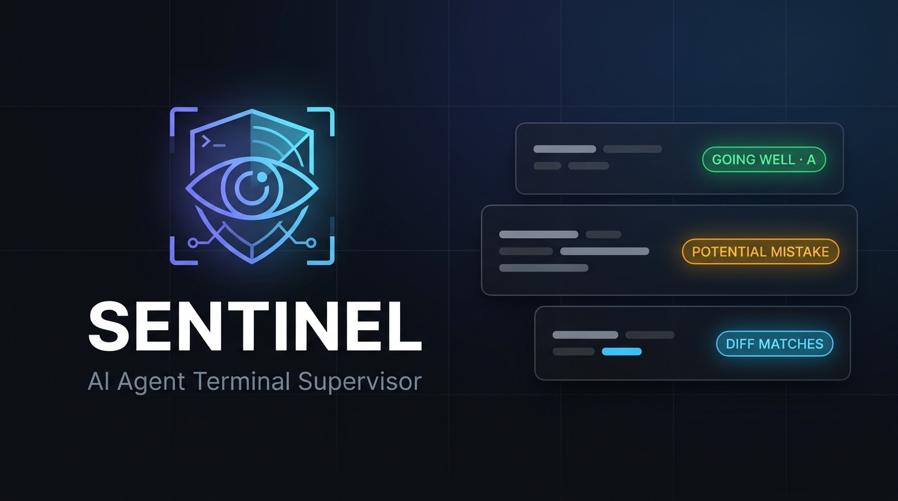

<p align="center">
  
</p>

# Sentinel

**Real-time supervisor for AI coding agents running in your terminals.**

Sentinel watches AI coding agents (`claude`, `codex`, `agy`, `aider`, `gemini`, `opencode`, `cursor`) across your macOS Terminal.app windows, cross-checks their actual `git diff` against what they claim to be doing, and grades their work with **Gemini 4 Hydrogen** (`gemini-4-hydrogen`).

## What Sentinel Checks

- **Live terminal progress & verdicts:**
  - `going_well` — Steady, on-task progress; file edits match claims
  - `waiting_for_user` — Paused waiting for approval or next instruction
  - `completed` — Task finished cleanly
  - `potential_mistake` — Likely bug, misunderstanding, or discrepancy between claims and actual edits
  - `stuck_in_loop` — Repeating the same failing commands, edits, or reasoning
  - `stuck_at_something` — Blocked on an error, hung process, or stalled while busy
  - `ignoring_instructions` — Contradicting explicit user constraints visible in the terminal
  - `taking_bad_initiative` — Making unrequested risky changes or going off-script
  - `sabotaging_work` — Destructive or dishonest actions (weakening tests, deleting needed files, bypassing checks, etc.)
- **Git diff vs. agent claims verification:** Resolves each terminal's working directory (via TTY `ps`/`lsof` with window-title fallback), captures `git status`, `git diff HEAD`, and recent commits, and checks whether actual file changes match what the agent says (`yes` | `partial` | `mismatch` | `no_diff`).
- **Actionable nudges:** Flags concrete `potentialMistakes` and drafts a ready-to-paste `messageToAgent` when you should warn or redirect an agent.
- **Adjustable live watch & cost tracking:** Polls on an adjustable interval (default `30s`, live toggle & presets in the dashboard), skips unchanged screens/diffs to save API calls, and tracks total Gemini 4 Hydrogen USD cost and token usage live.

## Auditor Models (Gemini, OpenRouter, & Local Ollama)

**Gemini 4 Hydrogen** (`gemini-4-hydrogen`) is the default auditor, and you can switch models live in the dashboard or via CLI/env:

| Alias | Model ID | Provider |
| --- | --- | --- |
| `hydrogen` (default) | `gemini-4-hydrogen` | Google AI Studio / OpenRouter |
| `haiku` | `anthropic/claude-haiku-5.5` | OpenRouter |
| `luna` | `openai/gpt-6-luna` | OpenRouter |
| `luna-pro` | `openai/gpt-6-luna-pro` | OpenRouter |
| `deepseek` | `deepseek/deepseek-v4.1-flash` | OpenRouter |
| `glm-flash` | `z-ai/glm-5.3-flash` | OpenRouter |
| `glm` | `z-ai/glm-5.3` | OpenRouter |
| *(any OpenRouter ID)* | e.g. `qwen/qwen3-coder` | OpenRouter |
| *(any Ollama model)* | e.g. `llama3.2`, `qwen2.5-coder` | Local Ollama (`$0`) |

## Quick Start

```bash
npm install
```

Set an API key in your environment (or `.env`) — or skip keys altogether when using **Ollama**:
- `GEMINI_EXPERIMENTAL` / `GEMINI_API_KEY` / `GOOGLE_GEMINI_API_KEY` (Google AI Studio)
- `OPEN_ROUTER_API_KEY` / `OPENROUTER_API_KEY` (OpenRouter — supports Haiku, Luna, DeepSeek, GLM, Gemini, and any custom OpenRouter model ID)
- `OLLAMA_BASE_URL` (optional, default `http://localhost:11434` — local models are auto-discovered in the dashboard)

Optional environment variables:
- `SENTINEL_PROVIDER` (`auto` | `google` | `openrouter` | `ollama`, default: `auto`)
- `SENTINEL_MODEL` (alias or model ID, default: `gemini-4-hydrogen`)
- `DISRUPTION_CODE_ROOTS` (colon-separated extra roots for repo lookup fallback, defaults to `~/Code:~/Projects:~/src:~/dev:~`)
- `PORT` (default: `4321`)
- `POLL_INTERVAL_MS` (default: `30000`)

### Web Dashboard (Live SSE + Model Switcher + Focus Terminal Window)

```bash
npm run dev
# Open http://localhost:4321
```

### CLI Monitor

```bash
# One-shot scan with default Gemini 4 Hydrogen
npm run scan

# Use a built-in alias (haiku, luna, deepseek, glm, glm-flash)
npm run cli -- --once --model haiku
npm run cli -- --once --model deepseek

# Use any custom OpenRouter model ID
npm run cli -- --once --provider openrouter --model qwen/qwen3-coder

# Use a local Ollama model ($0)
npm run cli -- --once --provider ollama --model llama3.2

# Live updating terminal dashboard (default every 30s)
npm run cli -- --notify --interval 30
```

## License

Licensed under the [Apache License 2.0](LICENSE).
